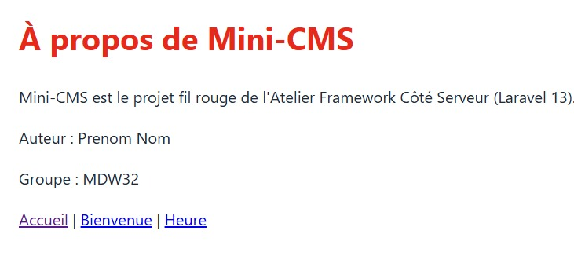
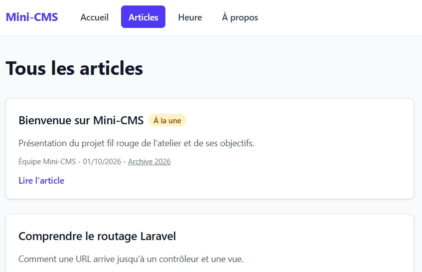
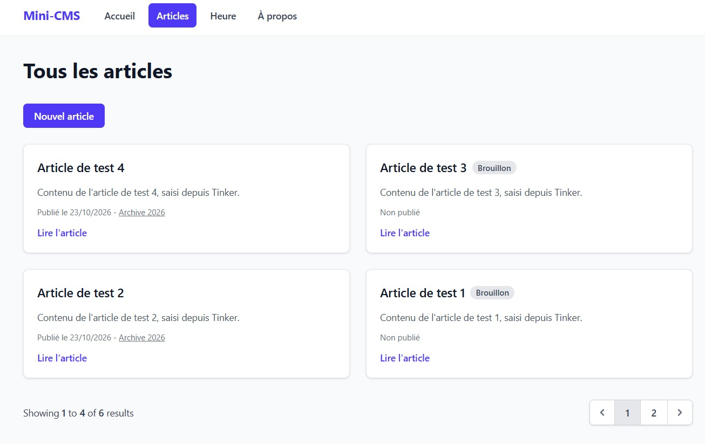
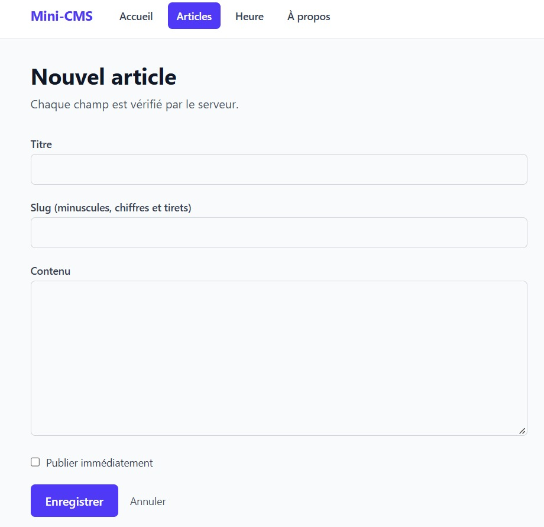

# Mini-CMS

Projet fil rouge de l'Atelier Framework Côté Serveur (Laravel 13, PHP 8.3+), 3e année MDW, ISET Sidi Bouzid.

Auteur : Ben rhouma maryem, groupe MDW32.

Mini-CMS évoluera au fil du semestre vers une petite plateforme de publication : pages publiques, back-office authentifié, API JSON et tests Pest. Chaque session se termine par un tag Git (`lab-01`, `lab-01b`, puis un tag par session).

## État actuel (tag lab-06)

- Authentification écrite à la main : inscription (`Hash::make`), connexion (`Auth::attempt`), déconnexion.
- Écritures réservées aux utilisateurs connectés (middleware `auth`) ; chaque article a un auteur.
- Colonne `role` (`author` ou `admin`), Gate `manage-categories` et `PostPolicy` (un auteur modifie ses articles, un administrateur tous).
- Tests Pest : `AuthTest` et `AuthorizationTest`, en plus des suites précédentes.


## Données de démonstration

Après un clone, reconstruire la base avec `php artisan migrate:fresh --seed`. Attention : cette commande vide la base avant de la remplir.


## Prérequis

- PHP et Composer (PHP 8.3 ou plus depuis https://www.php.net/downloads, avec les extensions curl, fileinfo, mbstring, openssl, pdo_sqlite, sqlite3 et zip activées dans php.ini, et Composer depuis https://getcomposer.org).
- Node.js LTS et npm.
- Git.

## Installation

### Bash (Git Bash, macOS, Linux)

```bash
git clone https://github.com/VOTRE-UTILISATEUR/mini-cms.git
cd mini-cms
composer install
npm install
cp .env.example .env
php artisan key:generate
touch database/database.sqlite
php artisan migrate
composer run dev
```

### PowerShell (Windows)

```powershell
git clone https://github.com/mariembr01/mini-cms.git
cd mini-cms
composer install
npm install
copy .env.example .env
php artisan key:generate
New-Item database\database.sqlite -ItemType File
php artisan migrate
composer run dev
```

Ouvrir ensuite http://localhost:8000 (adresse de l'application, différente de l'adresse de Vite sur le port 5173).

## Captures d'écran

### Page d'accueil


### Page Bienvenue


### Liste des routes


### Page À propos



## Routes disponibles

| Méthode | URI | Nom | Action |
|---|---|---|---|
| GET | `/` | `home` | `PageController@home` |
| GET | `/a-propos` | `about` | `PageController@about` |
| GET | `/heure` | `time` | `PageController@time` |
| GET | `/posts` | `posts.index` | `PostController@index` |
| GET | `/posts/archive/{year}` | `posts.archive` | `PostController@archive` |
| GET | `/posts/categorie/{category:slug}` | `posts.category` | `PostController@byCategory` |
| GET | `/posts/tag/{tag:slug}` | `posts.tag` | `PostController@byTag` |
| GET | `/posts/create` | `posts.create` | `PostController@create` |
| POST | `/posts` | `posts.store` | `PostController@store` |
| GET | `/posts/{post}` | `posts.show` | `PostController@show` |
| GET | `/posts/{post}/edit` | `posts.edit` | `PostController@edit` |
| PUT | `/posts/{post}` | `posts.update` | `PostController@update` |
| DELETE | `/posts/{post}` | `posts.destroy` | `PostController@destroy` |
| PATCH | `/posts/{post}/publication` | `posts.publication` | `PostController@togglePublication` |
| GET | `/admin/categories` | `admin.categories.index` | `CategoryController@index` |
| GET | `/admin/categories/create` | `admin.categories.create` | `CategoryController@create` |
| POST | `/admin/categories` | `admin.categories.store` | `CategoryController@store` |
| GET | `/admin/categories/{category}/edit` | `admin.categories.edit` | `CategoryController@edit` |
| PUT | `/admin/categories/{category}` | `admin.categories.update` | `CategoryController@update` |
| DELETE | `/admin/categories/{category}` | `admin.categories.destroy` | `CategoryController@destroy` |
| GET | `/admin/tags` | `admin.tags.index` | `TagController@index` |
| GET | `/admin/tags/create` | `admin.tags.create` | `TagController@create` |
| POST | `/admin/tags` | `admin.tags.store` | `TagController@store` |
| GET | `/admin/tags/{tag}/edit` | `admin.tags.edit` | `TagController@edit` |
| PUT | `/admin/tags/{tag}` | `admin.tags.update` | `TagController@update` |
| DELETE | `/admin/tags/{tag}` | `admin.tags.destroy` | `TagController@destroy` |

## 6. Historique depuis lab-01

Nombre de commits depuis lab-01 :

Fichiers modifiés depuis lab-01 :

Ce que git tag -n affiche pour lab-01 :

   ### Session 04

   
### Session 05





### Session 06


### Session 07


### Session 08


### Session 09


### Session 10

Back-office des catégories et des tags, messages de validation en français, pages 404 et 503 dans le layout du site.


## Comparaison avec le starter kit Livewire

| Critère | Mini-CMS (authentification manuelle) | Starter kit Livewire |
|---|---|---|
| Routes d'authentification | `routes/web.php` : `/inscription`, `/connexion`, `/deconnexion` | Enregistrées par Fortify depuis son paquet, absentes de `routes/web.php` |
| Inscription | `Auth\RegisterController` et `RegisterRequest` | `app/Actions/Fortify/CreateNewUser.php` et une vue Livewire |
| Connexion | `Auth\LoginController::store` (`Auth::attempt`, `regenerate`) | Contrôleur de Fortify et une vue Livewire |
| Déconnexion | `Auth\LoginController::destroy` (`logout`, `invalidate`, `regenerateToken`) | Route de Fortify, mêmes opérations dans `app/Livewire/Actions/Logout.php` |
| Limitation des tentatives | Aucune | 5 tentatives par minute par e-mail et IP (`FortifyServiceProvider`) |
| Mot de passe oublié | Absent | `Features::resetPasswords()` dans `config/fortify.php` |
| Vérification de l'e-mail | Absente | `Features::emailVerification()` et middleware `verified` |
| Double authentification | Absente | `Features::twoFactorAuthentication()` et passkeys |
| Rôles et autorisations | Colonne `role`, Gates, `PostPolicy`, middleware `admin` | Aucun : à écrire soi-même |
| Tests | `AuthTest`, `AuthorizationTest`, `AdminAccessTest`, `PostVisibilityTest` | 10 fichiers fournis (Auth, Settings, Dashboard) |

Ce que je garderais du kit dans un vrai projet : la limitation des tentatives de connexion, le mot de passe oublié et la vérification de l'e-mail, car ce sont des mesures de sécurité que je ne veux pas réécrire. Je garderais mes propres Gates et Policies, car le kit n'écrit aucune règle d'autorisation.